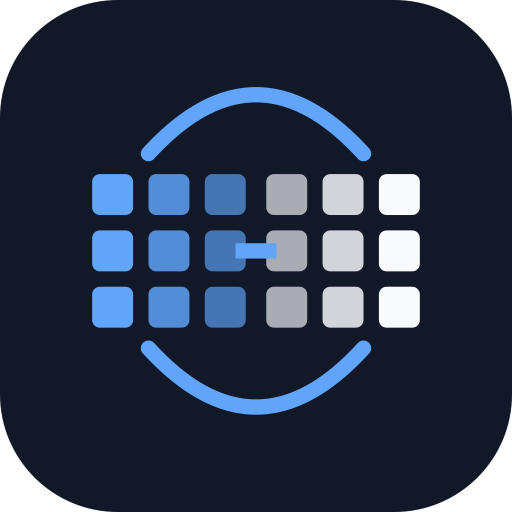
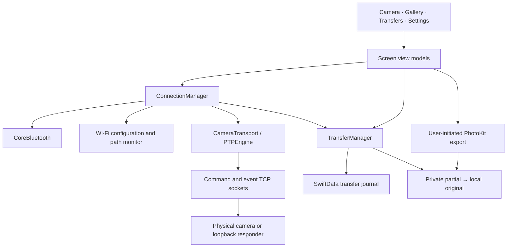
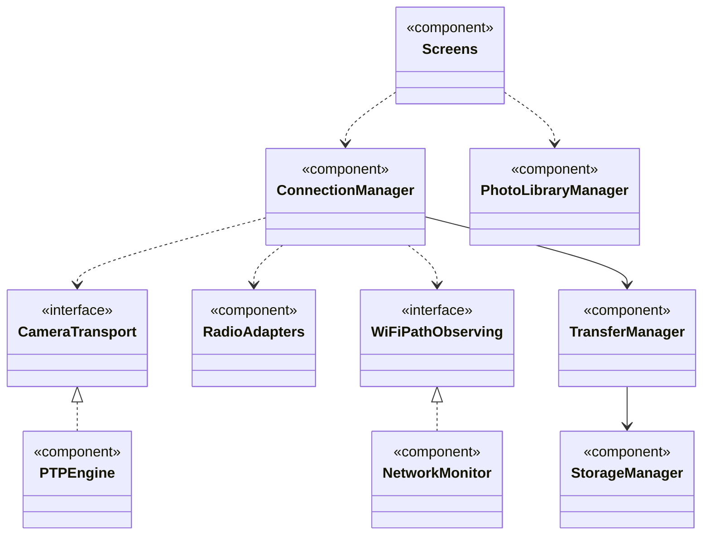
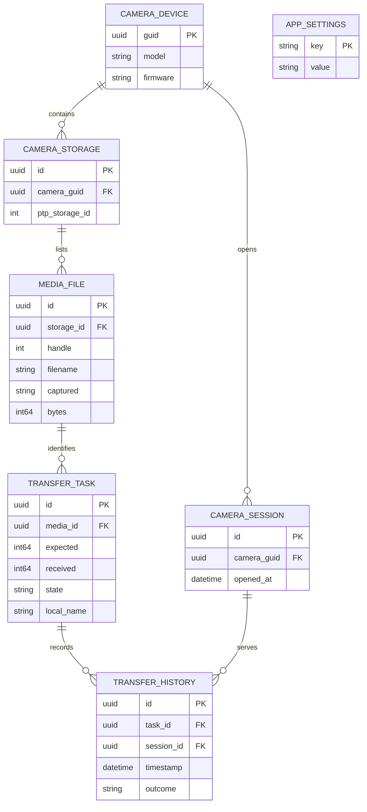

<p align="center">
  
</p>
<h1 align="center">PixelBridge</h1>
<p align="center"><strong>Connect Beyond the Lens.</strong></p>
<p align="center">
  
  
  
  
  
</p>
<p align="center"><a href="README.md">English</a> · <a href="README.zh-CN.md">简体中文</a></p>

PixelBridge brings camera originals directly to an iPhone or iPad over local Wi-Fi. In the field, a photographer can select a file, import it into Files, then choose whether to add it to Photos. The transfer path requires no internet connection or account.

**Current milestone** · A runnable SwiftUI prototype includes a loopback camera. Its sample JPEG travels through the same two-socket PTP/IP client and disk writer used by the manual camera connection. All seven target Nikon bodies await physical testing. [Build and test evidence](docs/validation.md)

## Try the transfer

1. Open `PixelBridge.xcodeproj` in Xcode, select the **PixelBridge** scheme and an iPhone or iPad simulator, and run.
2. In **Camera**, tap **Open demo camera**. When the state becomes **Ready**, open **Gallery → TestChart.jpg**.
3. Tap **Load thumbnail**, then **Download original**. Open **Transfers** to share the saved file or export it to Photos. Normal launches store originals in **Files → On My iPhone/iPad → PixelBridge → Imports**.

## Camera and transfer capabilities

| Area | Prototype behavior |
| --- | --- |
| Connection | Scan for nearby camera names over BLE and open a GATT link. For media, join a camera hotspot in Settings or enter its SSID in the app. Supply the private camera IPv4 address. Nikon application pairing and BLE wake remain experimental work. |
| Browsing | Read model and firmware, enumerate cards and inspect up to 200 object handles. Search filenames and fetch a thumbnail on demand. |
| Transfer | Stream one original to a private partial, show speed and remaining time, verify the byte count and publish to Files. The SwiftData journal survives app relaunch. |
| Interruption | Watch both the Wi-Fi path and TCP session. Keep the partial and reconnect with bounded retries. A matching interrupted object restarts at byte zero. |

## Architecture



<details>
<summary>UML components</summary>



</details>

<details>
<summary>Persistent data model · target schema</summary>



</details>

The transfer journal is the current SwiftData entity. Catalog normalization and separate attempt history are planned. [Architecture and sequence diagrams](docs/architecture.md) · [Wire protocol](docs/protocol.md)

## Stack and source tree

SwiftUI and Observation drive the screens. CoreBluetooth, Network.framework and NetworkExtension handle device connections. ImageIO decodes previews, FileHandle writes originals, PhotoKit exports them and Keychain stores optional credentials. Swift Testing covers protocol and recovery behavior. XCTest drives the interface.

```text
PixelBridge.xcodeproj/              Shared app, unit-test and UI-test scheme
PixelBridge/App/                   Entry point, permissions and entitlements
PixelBridge/Views/ · ViewModels/    Camera, gallery, transfers and settings
PixelBridge/Models/                Session, media and journal types
PixelBridge/Core/                  Bluetooth, Connection, Network, Protocol,
                                   Simulation, Storage and Transfer
PixelBridge/Resources/             Original AppIcon, test JPEG and MIT notice
PixelBridgeTests/ · PixelBridgeUITests/
assets/ · docs/                    Original artwork and engineering notes
```

## Nikon compatibility

| Target bodies | Firmware tested | PixelBridge hardware status |
| --- | --- | --- |
| Z9 · Z8 · Z6 III · Z5 II · Zf · Z50 II · ZR | — | Untested |

The first acceptance gate is a real JPEG whose SHA-256 matches the memory-card copy. Firmware-specific BLE, Wi-Fi, NEF, video, off-state upload and resume each have a separate field. [Per-camera profiles](docs/compatibility.md)

## Roadmap

1. **Connectivity** — verify Wi-Fi, session setup, permissions and camera identity on hardware.
2. **Media** — validate card slots, large galleries, EXIF, RAW and video metadata.
3. **Transfer** — verify original files, Photos import and queued batches in the field.
4. **Advanced connectivity** — evaluate byte ranges, low-power BLE, background operation and Upload While Off by firmware.
5. **Release** — measure memory, energy and throughput, then sign and distribute a TestFlight build. [Acceptance gates](docs/roadmap.md)

## Build and test

Requires Xcode with Swift Testing (Xcode 16 or later) and an installed iOS simulator. The deployment target is iOS/iPadOS 17. Open the checked-in project directly. XcodeGen is optional for regenerating it after edits to `project.yml`.

```sh
xcodebuild -scheme PixelBridge -showdestinations
# Replace SIMULATOR_UDID with an available simulator ID.
xcodebuild -scheme PixelBridge -destination 'id=SIMULATOR_UDID' test
```

For a physical device, set your development team and enable the Hotspot Configuration capability for its App ID. Join camera Wi-Fi and allow Local Network access when prompted.

## Upstream references

AeroShutter Mobile supplied MIT-licensed packet helpers. ZENCHE and libgphoto2 informed the transport design. NikonLink documents an Android Z5 experiment. The research report records exact revisions, license scope, model claims and what ships in this binary. [Review and source links](docs/research.md) · [Bundled attribution](PixelBridge/Resources/Notices/AeroShutter-MIT.txt)

## Privacy and security

Photos stay on the camera and the receiving device. Camera TCP is local and unencrypted. Use a trusted, password-protected camera network. Password storage is opt-in and device-only. Photos export asks for add-only permission. The app includes no cloud client, analytics or advertising SDK.

## Contributing

Include camera model, firmware, iOS version, connection mode, file type and the first failing operation in hardware reports. Use synthetic fixtures or redact private images, network passwords and serial numbers. Submit protocol changes with wire vectors or reproducible failure tests.

## License and disclaimer

PixelBridge contributions use the MIT license. Retain the upstream notice when distributing the app. PixelBridge is an independent project with no official affiliation with Nikon Corporation or Apple Inc. [License](LICENSE)
