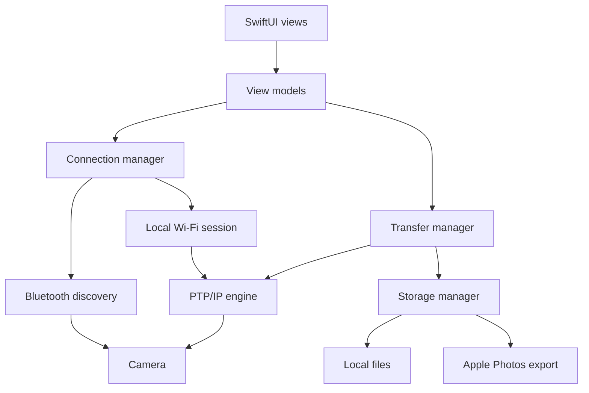
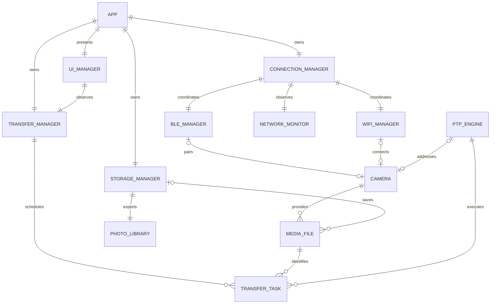

  

# PixelBridge

An offline-first wireless camera transfer project for iPhone and iPad.

PixelBridge 的目标是在拍摄现场把尼康相机里的原片传到 iPhone 或 iPad。手机连着相机热点时，即使没有互联网，也应能选片、下载并在本机查看。

**Project status** · Repository setup and icon assets are complete. The Swift application, camera protocol integration and device tests are planned. There is no installable build yet.

## Overview

The first field test has one goal. A photographer joins the camera’s Wi-Fi network, opens PixelBridge, chooses one JPEG, and receives an intact local copy. Bluetooth discovery, RAW files, video and batch import each get their own milestone so a successful JPEG test cannot be mistaken for broader compatibility.

## Features and connection behavior

| Field condition | Intended behavior |
| --- | --- |
| Phone joins the camera’s Wi-Fi, with no internet | Open a local PTP/IP session. Browse and download from the camera without an account or cloud service. |
| Phone turns Wi-Fi off or leaves the camera network | Pause the active transfer, keep finished files, and show the interruption. Reconnect to the same camera and retry the unfinished file. |
| Phone has cellular internet only | Keep local imports available. Show that a camera Wi-Fi connection is required to fetch another original. |
| Camera power switch turns off | Keep the pending task. Continue only if that model and connection mode still provide the required session. Verify each combination on hardware. |

An interrupted download should remain a temporary file until its size is checked. The first transfer milestone restarts that file from the beginning. Byte-range resume is a later experiment.

On Nikon's Z8, the camera manual limits **Upload while off** to Bluetooth or a Wi-Fi access point connection. The camera acting as the phone's hotspot is a separate mode. PixelBridge support for either path needs its own device test. [Z8 network menu](https://onlinemanual.nikonimglib.com/z8/en/nwm_connect_to_smart_device_358.html) · [Nikon direct Wi-Fi guide](https://nikonimglib.com/snbr/onlinehelp/en/direct_wifi_connection_5.html)

## Architecture

The diagrams describe the planned application. The local import flow and the optional system Photos export are separate destinations.

### Component relationships

The camera links below represent the single-camera session in the first release. A file can have several transfer attempts. A saved local file remains available after its camera disconnects.

## Technology stack

| Layer | Planned implementation |
| --- | --- |
| Interface | SwiftUI for iOS and iPadOS |
| Camera discovery | Core Bluetooth for supported pairing flows, with manual Wi-Fi connection as the first test path |
| Local transport | Network.framework for camera connections and path changes, with PTP/IP for media operations |
| Persistence | SwiftData for camera records and transfer state, files on disk for original media |
| Export | PhotoKit for user-initiated saves to the system photo library |

Two existing implementations are relevant to the protocol work. AeroShutter Mobile documents a Nikon D5300 transfer flow and uses the MIT license. The libgphoto2 camera library uses LGPL-2.1. This initial commit includes no code from either project. [AeroShutter Mobile](https://github.com/subhashraveendran/aero-shutter-mobile) · [libgphoto2](https://github.com/gphoto/libgphoto2)

## Project structure

| Path | Responsibility |
| --- | --- |
| `App/`, `Views/`, `ViewModels/` | App entry point, screens and presentation state |
| `Models/` | Paired camera, media item and transfer task |
| `Core/Connection/`, `Core/Bluetooth/`, `Core/Network/` | Session coordination, nearby discovery and network changes |
| `Core/Protocol/`, `Core/Transfer/`, `Core/Storage/` | Camera operations, download queue and local files |
| `Tests/` | Protocol fixtures and transfer-state tests |
| [assets/logo.svg](assets/logo.svg) | Vector artwork used at the top of this page |
| [AppIcon.appiconset](Resources/Assets.xcassets/AppIcon.appiconset) | The same artwork as an opaque 1024 × 1024 app icon. The square canvas extends the original background for the system icon mask. |

The source and test folders are reserved for implementation. The icon catalog is ready to add to an Xcode application target.

## Compatibility

| Target cameras | PixelBridge verification |
| --- | --- |
| Nikon Z8, Z9 | Planned |
| Nikon Z6III, Z5II, Zf | Planned |
| Nikon Z50II, ZR | Planned |

A verified result should identify the camera, firmware, iPhone or iPad model, OS version, connection mode and file type. Record browsing, downloading and power-off behavior separately.

## Roadmap

| Phase | Acceptance check |
| --- | --- |
| 1 · Connectivity | Discover a camera on supported hardware, establish a session over local Wi-Fi and identify the camera with internet access disabled. |
| 2 · Media transfer | Browse thumbnails and download one original JPEG. Interrupt Wi-Fi mid-file, retry, and compare the final file with the memory-card copy. Then repeat for NEF, video and batches. |
| 3 · Advanced features | Test Bluetooth-assisted connection, queue recovery after relaunch, Photos export and power-off behavior by model. |
| 4 · Release | Publish a tested compatibility matrix and a build with reproducible on-device setup instructions. |

## Privacy

The design keeps originals on the camera and the receiving device. System Photos export is a user action. The planned transfer flow requires no cloud account or analytics service.

## Contributing

For a camera test, include the details listed under Compatibility and the exact step that succeeded or failed. For protocol changes, describe the expected response and how the client should recover from disconnection. Remove camera serial numbers, network passwords and personal images from shared samples.

## License

A project license has not been selected. Upstream reference projects retain their own licenses.

## Disclaimer

PixelBridge is an independent project. Nikon and SnapBridge are trademarks of Nikon. Nikon does not sponsor or endorse PixelBridge.
