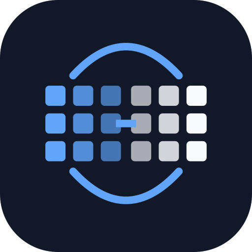
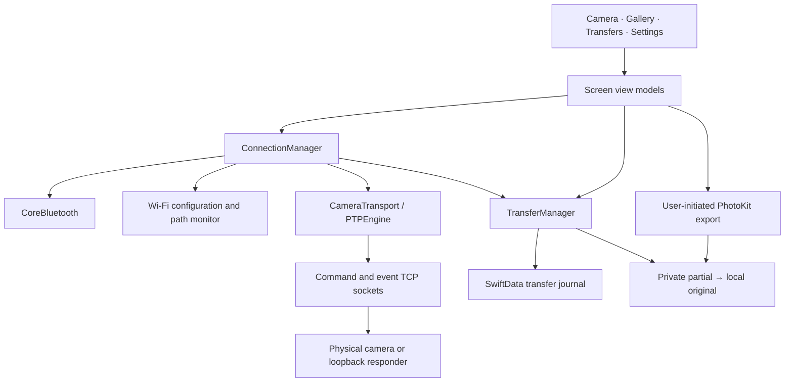
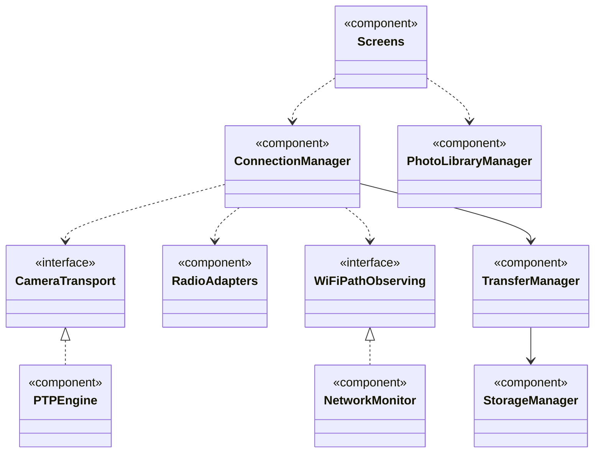
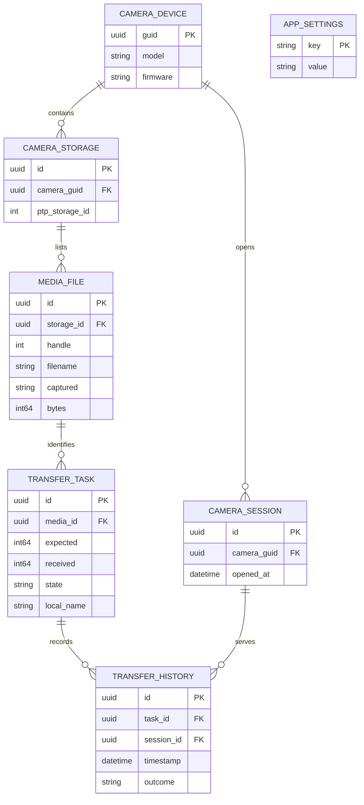

<p align="center">
  
</p>
<h1 align="center">PixelBridge · 像素桥</h1>
<p align="center"><strong>Connect Beyond the Lens.</strong></p>
<p align="center">
  
  
  
  
  
</p>
<p align="center"><a href="README.md">English</a> · <a href="README.zh-CN.md">简体中文</a></p>

PixelBridge 让摄影师通过局域网把相机原片直接传到 iPhone 或 iPad。连上相机热点后，可以选片、下载到「文件」，再按需导入系统相册。传输无需互联网或账号。

**当前进度** · SwiftUI 原型已可运行。内置模拟相机的测试 JPEG 与手动连接相机共用双通道 PTP/IP 客户端和磁盘写入流程。七款目标尼康机身均待真机验证。 [构建与测试记录](docs/validation.md)

## 体验一次传输

1. 在 Xcode 打开 `PixelBridge.xcodeproj`，选择 **PixelBridge** scheme 和 iPhone 或 iPad 模拟器，运行工程。
2. 在 **Camera** 点 **Open demo camera**，状态变为 **Ready** 后打开 **Gallery → TestChart.jpg**。
3. 点 **Load thumbnail** 查看缩略图，再点 **Download original**。在 **Transfers** 中可以分享文件或导入相册。正常启动时，原片保存在 **文件 → 我的 iPhone/iPad → PixelBridge → Imports**。

## 连接与传输能力

| 模块 | 当前行为 |
| --- | --- |
| 相机连接 | 通过 BLE 广播名称发现候选相机并打开 GATT 链路。传图时可在系统设置加入相机热点，也可在 App 输入 SSID 申请加入，再输入相机的局域网 IPv4 地址。尼康应用层配对和 BLE 唤醒仍待实验。 |
| 媒体浏览 | 读取机型、固件和存储卡，最多检查 200 个对象句柄。可搜索文件名、按需读取缩略图。 |
| 文件传输 | 一次流式下载一个原片，显示速度和预计剩余时间。下载期间写入临时文件，核对长度后移入「文件」。SwiftData 保存传输记录。 |
| 连接中断 | 同时监测 Wi-Fi 路径和 TCP 会话。保留临时文件，有限次重连。重新确认文件身份后从头读取。 |

## 系统架构



<details>
<summary>UML 组件关系</summary>



</details>

<details>
<summary>持久化数据模型 · 目标设计</summary>



</details>

当前 SwiftData 保存传输任务。独立相机目录、历史尝试表和迁移方向见架构文档。[架构与时序图](docs/architecture.md) · [传输协议](docs/protocol.md)

## 技术栈与目录

SwiftUI 和 Observation 驱动界面。CoreBluetooth、Network.framework 和 NetworkExtension 管理连接，ImageIO 解码预览，FileHandle 写入原片，PhotoKit 导入相册，Keychain 保存用户选择记住的凭据。Swift Testing 验证协议和恢复流程，XCTest 验证界面操作。

```text
PixelBridge.xcodeproj/              工程与共享 scheme
PixelBridge/App/                   入口、权限与签名能力
PixelBridge/Views/ · ViewModels/    相机、图库、传输和设置
PixelBridge/Models/                会话、媒体、传输记录
PixelBridge/Core/                  连接、蓝牙、网络、协议、模拟相机、存储与传输
PixelBridge/Resources/             原始 AppIcon、测试 JPEG、第三方许可
PixelBridgeTests/ · PixelBridgeUITests/
assets/ · docs/                    原始图形与工程文档
```

## 尼康相机兼容性

| 目标机型 | 已测固件 | PixelBridge 真机状态 |
| --- | --- | --- |
| Z9 · Z8 · Z6 III · Z5 II · Zf · Z50 II · ZR | — | Untested（待测） |

首个验收目标是下载一张真机 JPEG，并与存储卡原件比对 SHA-256。每款机型的 BLE、Wi-Fi、NEF、视频、关机后上传和续传独立记录。[分机型能力表](docs/compatibility.md)

## 开发路线

1. **连接** — 在真机验证 Wi-Fi、会话建立、权限和设备身份。
2. **媒体管理** — 验证不同卡槽、大图库、EXIF、RAW 和视频信息。
3. **传输** — 核验原片、相册导入和批量任务。
4. **高级连接** — 按固件验证字节续传、低功耗 BLE、后台行为与关机后上传。
5. **发布** — 测量内存、功耗和吞吐量，再签名并开展 TestFlight 测试。[分阶段验收条件](docs/roadmap.md)

## 安装、构建与测试

使用支持 Swift Testing 的 Xcode（16 或更高版本）并安装 iOS 模拟器。最低部署版本为 iOS/iPadOS 17。已提交的工程可直接打开。修改 `project.yml` 后可用 XcodeGen 重新生成工程。

```sh
xcodebuild -scheme PixelBridge -showdestinations
# 将 SIMULATOR_UDID 替换为上一步列出的模拟器 ID
xcodebuild -scheme PixelBridge -destination 'id=SIMULATOR_UDID' test
```

在实体设备上选择自己的开发团队，为 App ID 启用 Hotspot Configuration，加入相机 Wi-Fi，并在系统询问时授予本地网络权限。

## 开源引用

封包辅助函数移植自 MIT 许可的 AeroShutter Mobile。传输设计参考了 ZENCHE 和 libgphoto2。NikonLink 提供了 Android 与 Z5 的实验记录。调研报告逐项列出了源码版本、许可、验证范围与实际复用内容。[调研与来源](docs/research.md) · [随 App 分发的版权声明](PixelBridge/Resources/Notices/AeroShutter-MIT.txt)

## 隐私与安全

照片仅在相机与接收设备之间传输。PTP/IP 使用明文局域网 TCP，应在可信的加密相机热点使用。仅在用户选择记住时，密码才保存在本机 Keychain。导入相册时请求仅添加权限。App 无需云服务、统计或广告 SDK。

## 贡献指南

反馈真机结果时，请注明机型、固件、iOS 版本、连接模式、文件类型及首次失败的操作。协议改动请附封包样例或可复现测试。共享记录前移除序列号、网络密码和私人影像。

## 许可证与声明

PixelBridge 项目代码采用 MIT 许可证。分发时请保留随附的第三方版权声明。本项目独立开发，与 Nikon Corporation 和 Apple Inc. 无官方隶属关系。[项目许可证](LICENSE)
