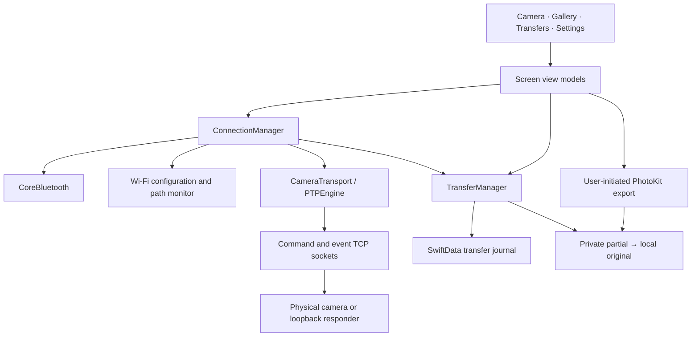
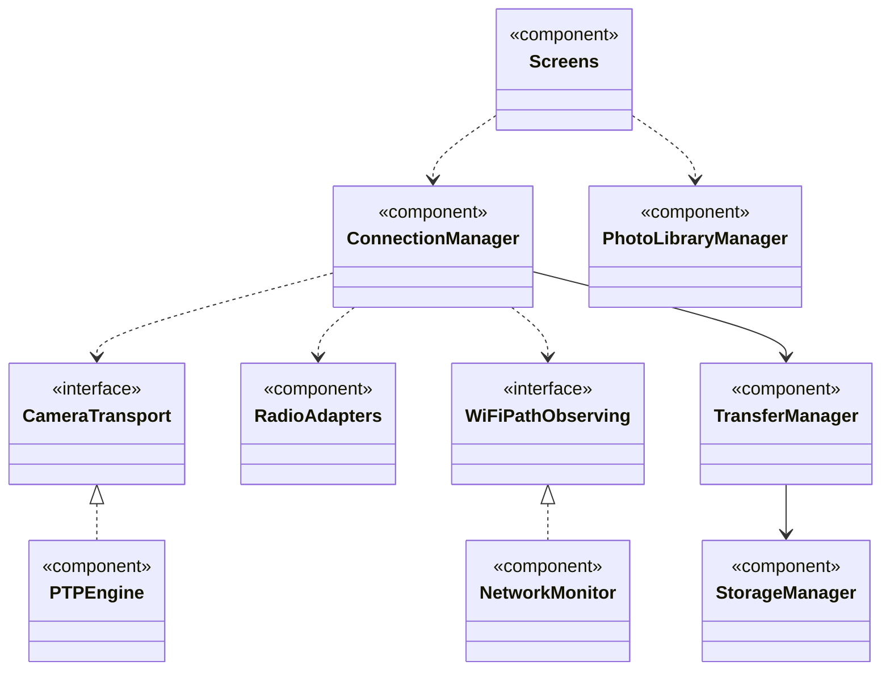
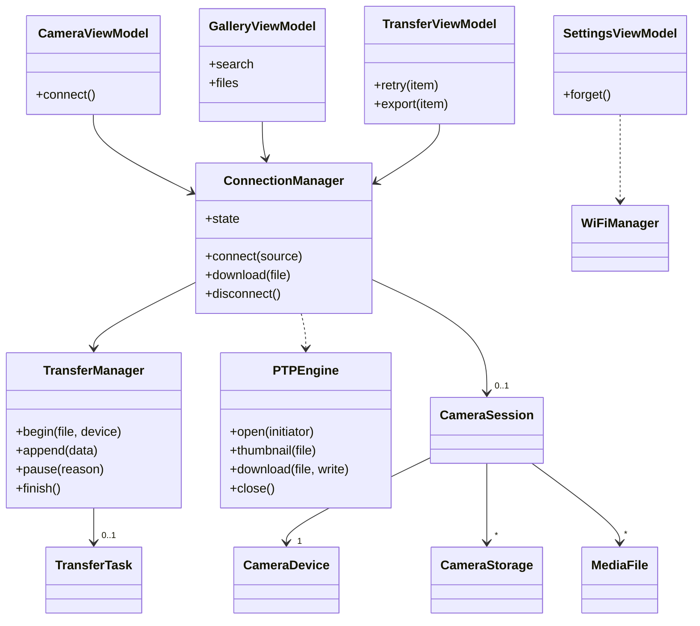
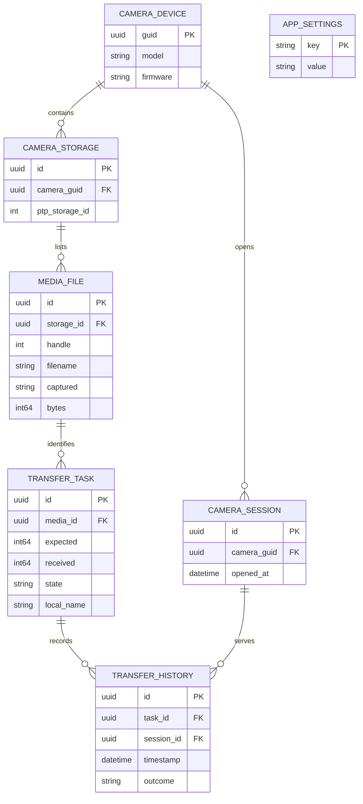
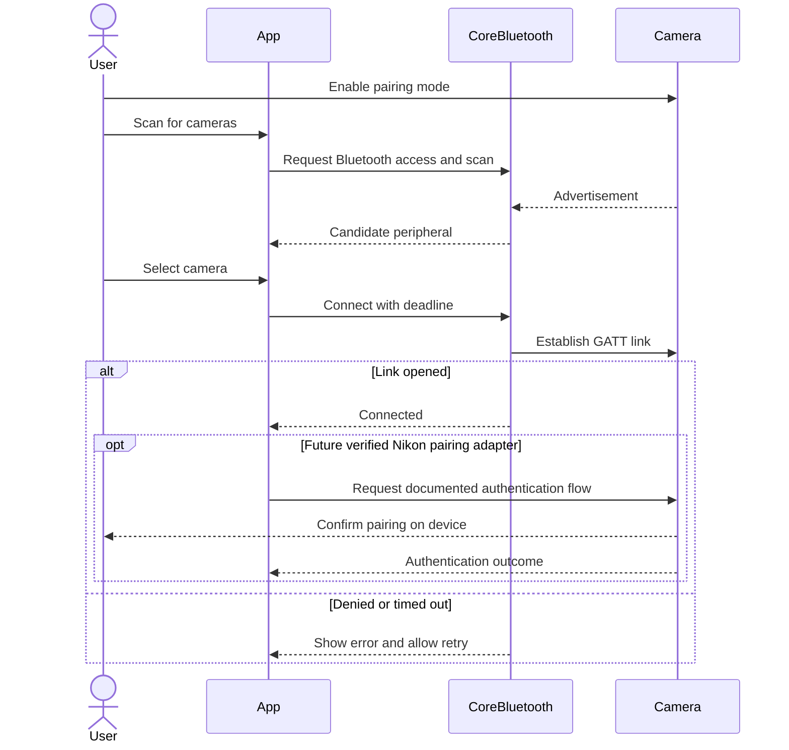
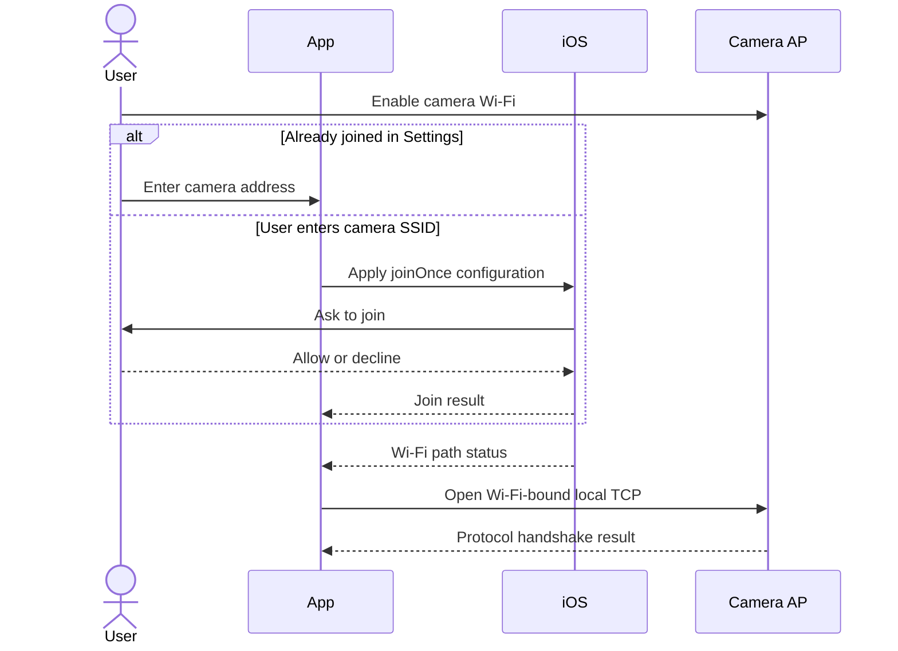
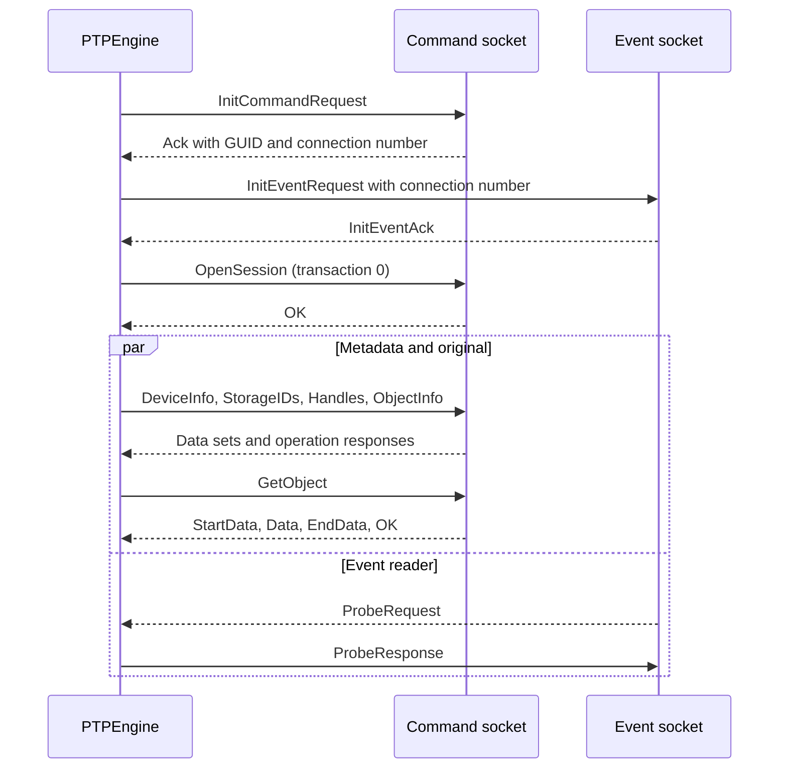
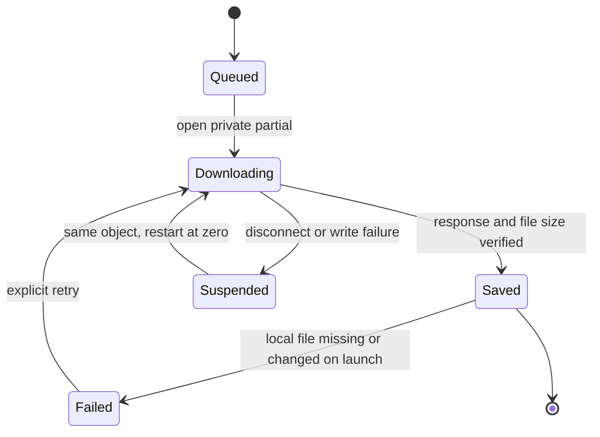
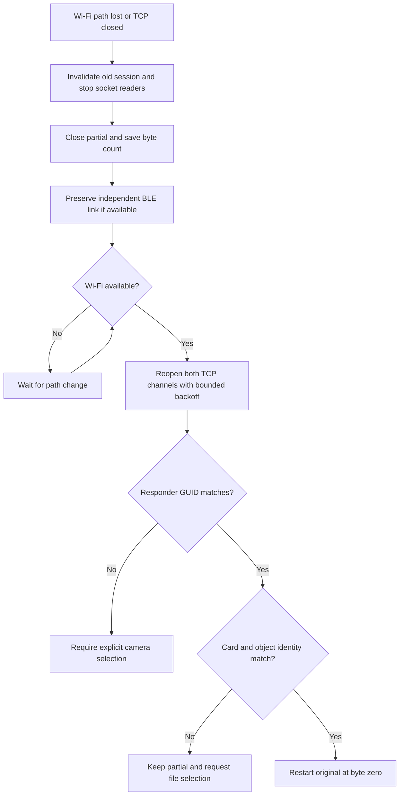

# Architecture

PixelBridge runs entirely on the receiving device. The first working slice opens a PTP/IP session, browses media and commits one original to disk. The physical camera and the bundled responder meet the same TCP contract. SwiftUI Observation and SwiftData set the deployment floor at iOS/iPadOS 17. The shared Xcode scheme includes app, Swift Testing and XCTest UI targets.

## System layers

## UML components

Mermaid class notation with UML component stereotypes expresses usage and provided interfaces. Multiplicity for persistent entities is specified in the ER diagram.

## UML classes

## Persistent data model

The diagram defines the normalized target schema. Today SwiftData persists TRANSFER_TASK with a snapshot of camera GUID, storage ID, handle, name, capture time and expected size. The catalog and active session live in memory. TransferHistory currently projects journal rows. AppSettings uses UserDefaults and an optional hotspot password uses device-only Keychain. Introducing separate catalog/history tables will require a migration from these snapshots.

## BLE pairing

Only discovery and GATT connection ship in the prototype. Nikon authentication and Wi-Fi activation below require per-model evidence.

## Wi-Fi joining

## PTP/IP session

## Transfer state machine

## Loss and recovery

The coordinator owns one operation at a time. A generation identifier prevents an old callback from writing to a later transfer. A single idle event reader can run alongside the command transaction. SwiftData is isolated to the main actor. A successful move followed by process termination is reconciled from the actual final file size on the next launch. [Wire limits](protocol.md)
